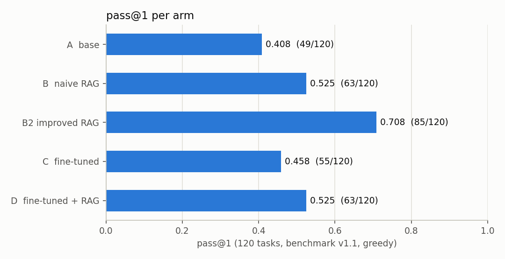
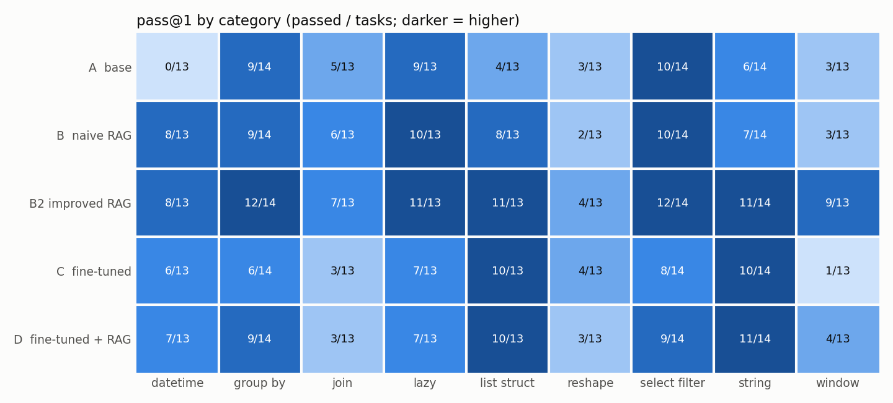

# Polars Code Generation: RAG vs Fine-Tuning

**Question.** Polars 2.0 removed or renamed many APIs that a small LLM learned
from older code (`groupby`, `melt`, `with_row_count`, `pivot(columns=)`,
`how="outer"`, ...). Given only the Polars 2.0 documentation, is it better to
**retrieve** the docs into the prompt (RAG) or to **fine-tune** the model on
examples derived from the same docs?

This README is the project report. [`PLAN.md`](PLAN.md) is the full plan and
decisions log; every number below is recorded there with its provenance.

All five arms were generated on the same GPU (an NVIDIA L4). The adapter was
trained on an A100; an earlier A100 generation run of C/D is kept as a
hardware-sensitivity check (see Limitations).

## Setup

| | |
|---|---|
| Model | `Qwen/Qwen3.5-4B` (instruct), bf16, no quantization, thinking off |
| Benchmark | 120 hand-written tasks, git tag `benchmark-v1.1`: 9 categories (select_filter, group_by, join, window, lazy, string, datetime, list_struct, reshape), 40 easy / 50 medium / 30 hard |
| Scoring | the generated `solve()` runs in a sandbox under `polars==2.0.0`; pass = output frame equals the reference's (per-task row/column-order flags, numeric widths ignored). Failures are classified: `wrong_result`, `hallucinated_api`, `deprecated_api`, `runtime_error`, `syntax_error`, ... |
| Decoding | greedy, `max_new_tokens=768`, batch 8, **one prompt template for all arms**; RAG arms only fill its `{context}` block; all arms generated on an NVIDIA L4 |
| Metric | pass@1 (one greedy sample per task) |

| Arm | Model | Context |
|---|---|---|
| **A** base | base model | none |
| **B** naive RAG | base model | top-5 doc chunks (2,000 tokens), query = instruction, granite-small-r2 embeddings + BM25 (RRF) |
| **B2** improved RAG | base model | one round of retrieval fixes, chosen on API recall only: filtered corpus, query = instruction + the model's own zero-shot draft, k=8, 4,000 tokens |
| **C** fine-tuned | base + LoRA adapter | none |
| **D** hybrid | base + LoRA adapter | B2's retrieval, with C's output as the draft |

## Results



| Arm | pass@1 | pass | wrong_result | hallucinated_api | runtime_error | deprecated_api | syntax_error |
|---|---|---|---|---|---|---|---|
| A | **0.408** | 49 | 19 | 30 | 19 | 3 | 0 |
| B | **0.525** | 63 | 23 | 15 | 13 | 5 | 1 |
| B2 | **0.708** | 85 | 17 | 3 | 14 | 1 | 0 |
| C | **0.458** | 55 | 23 | 21 | 16 | 3 | 2 |
| D | **0.525** | 63 | 22 | 15 | 20 | 0 | 0 |



### Findings

1. **RAG beats fine-tuning on the same docs.** Naive RAG (B, 0.525) already
   beats the fine-tuned model (C, 0.458), and one round of retrieval fixes
   (B2, 0.708) adds another 18 points. Both use only the Polars 2.0 docs.
2. **Fine-tuning fixes API names but weakens multi-step answers.** C vs A:
   27 tasks gained, 21 lost (net +6, +0.050). The gains are mostly corrected
   names in the categories the training data covers well (datetime +6,
   list_struct +7, string +6; 12 of the 27 gains were A `hallucinated_api`
   failures). The losses come from shorter answers that leave out part of the
   instruction. The median solution is 2 lines (A: 3). `.select(` appears in
   11 of 120 C answers (A: 25) and 11 C wrong results are extra output columns
   (B2: 3). `.sort(` appears 6 times (A: 24). Window tasks use `.over(` in 3/13
   answers (A: 8), and the model invents names instead (`running_sum`,
   `mean_over`, `prev_by`). Window drops to 1/13 and group_by to 6/14. This
   matches the training data: only 3 of 1,080 training solutions use `.over(`,
   and 44% are select/filter examples.
3. **The hybrid is worse than RAG alone.** D (0.525) vs B2 (0.708): 7 gained,
   29 lost, with the same failure modes as C (missing projections and sorts,
   invented window APIs). Retrieval still helps the fine-tuned model (C -> D:
   +16 / -8) but much less than the base model (A -> B2: +36 net). With
   retrieval, the fine-tuned model only reaches naive RAG's score (D = B = 63/120,
   on different tasks: 17 gained, 17 lost). Oracle unions show how little the
   two approaches complement each other here: B2 or D passes 92/120, B2 alone 85.
4. **Retrieval quality matters more than retrieval itself.** B's gain over A
   is mostly fewer hallucinated APIs (30 -> 15). B2's changes (dropping SQL
   reference pages and duplicates, the draft-code query, a bigger budget)
   raised non-core API recall from 0.28 to 0.54 and pass@1 by 18 points. The
   gains are largest in window (3 -> 9 of 13) and string (7 -> 11 of 14).
   Reshape stays the hardest category for every arm (at most 4/13).

## Training data pipeline (data v1)

All training data comes from the Polars 2.0 docs, the same source RAG uses.
The instructions were written by an open model, so no Claude-written text
enters training.

| Step | Output |
|---|---|
| Doc examples -> tasks (`datagen/convert.py`): each displayed doctest value / `print` becomes a candidate; its data constructions go to setup, the rest to `solve()` | 1,540 unique candidates |
| Sandbox validation under 2.0.0 (clean, no warnings, DataFrame result, two runs agree) | 1,331 valid |
| Drop solutions that call no documented API (71), leakage control vs the 120 benchmark tasks (6: solution similarity, structure, API set; the instruction-similarity check, calibrated against the benchmark's own nearest-neighbour cosine, dropped 0), downsampling of trivial single-API examples (63) | **1,191 candidates** |
| Requests written by `Qwen/Qwen3.5-9B` (one concise + one descriptive per candidate) + form filters (no method names, no code, length, output columns named) | **2,287 requests** |
| **Round trip**: Qwen3.5-9B solves each request from setup + oracle docs (the example itself removed) and its output must equal the reference | kept **1,428** (0.624) |
| Manual audit of 20 kept: **4/20 wrong** (all "output-equivalent": the request describes the output on this input, not the code) -> remedy: drop every kept request whose solver code uses none of the reference's non-core APIs (`api_mismatch`) | **1,202** (226 dropped) |
| Page-grouped 90/10 split | **train 1,080 / dev 122** |

Training (`train/sft.py`, Unsloth): LoRA r=16, alpha=16 on all attention + MLP
projections, lr 2e-4 cosine, 2 epochs, effective batch 16, loss on the
completion only, same prompt as Arm C. On the A100-80GB it took **438 s**
(136 steps) with **12.45 GB peak VRAM**. Train loss went from 0.375 to 0.061;
**dev loss was 0.189 after epoch 1 and 0.190 after epoch 2** (flat).

## Cost

Both runs on the NVIDIA L4, batch 8, 120 tasks (retriever load time excluded):

| Arm | Draft | Retrieval | Generation | End-to-end | Completion tokens (draft + final) |
|---|---|---|---|---|---|
| B2 | 175.5 s (Arm A) | 27.5 s | 339.4 s | **542.4 s (4.52 s/task)** | 6,941 + 6,685 |
| D | 229.4 s (Arm C) | 30.9 s | 258.4 s | **518.7 s (4.32 s/task)** | 5,545 + 5,386 |

D is 4% faster end to end: its final generation is 24% faster (shorter
answers; prompts are the same size, +0.5% tokens), but its draft is 31% slower
than Arm A's even though it writes fewer tokens (the LoRA adapter is applied
unmerged at inference). D also needs the one-off training run (438 s on an
A100). For reference, Arm B's generation took 242.3 s and Arm C's 229.4 s on
the L4.

## Limitations

- **AI-labelled audits.** The round-trip audit labels come from an AI
  reviewer (Claude) and were accepted by the user. They are not the judgement
  of a human Polars expert. The second audit (20 random kept requests after
  the remedy) found **1/20 wrong**, below the 3/20 threshold: A16 asks for
  "the last string value" of `ham` while the code takes `max()`; on that input
  the maximum is also the last value, so the round trip could not catch it.
  Its labels were filled in after notebook 06 had run (the run proceeded on
  the identical pre-labels).
- **Conservative round trip.** Of 20 audited rejections, 14 were correct
  requests that the 9B solver could not implement (Wilson 95% CI 0.48-0.85).
  So roughly 600 of the 859 rejected requests were probably usable. The
  filter keeps quality high but removes exactly the hard examples.
- **Under-represented categories.** In train, group_by is 2.2%, reshape 2.6%
  and window 8.0%, against about 11% each in the benchmark. select_filter is
  44% of train (12% of the benchmark), and the multi-step share fell from 0.28
  to 0.18 through the round trip. Arm C's results on these categories are
  limited by the data, not only by the method.
- **Single seed, single sample.** One greedy run per arm. A difference of a
  few tasks (e.g. B 63 vs D 63, C 55 vs A 49) is close to noise.
- **Flaky tasks.** Polars' streaming engine does not guarantee `group_by`
  order. A determinism audit (each generation re-run 50 times) found 0 flaky
  pass/fail outcomes in A, B, B2 and D, and 2 in C. In both C cases the code
  leaves out a sort that the instruction asks for, so it passes only by chance
  (`lazy_011` stored as a pass and `lazy_012` stored as a fail, each passing
  26/50 runs). The reported score keeps the stored outcome; counting both as
  failures gives 54/120 = 0.450.
- **Hardware sensitivity.** The official C/D runs are on the L4 like A/B/B2
  (pre-registered before the L4 run). An earlier run of the same adapter on an
  A100 (`results/C_a100`, `results/D_a100`) gives C 56/120 and D 62/120. Between
  the GPUs, 111/120 C answers and 108/120 D answers are byte-identical; C flips
  1 task (`group_by_002`, pass on the A100 only), D flips 3 (`lazy_012` and
  `window_001` pass on the L4 only, `datetime_013` on the A100 only). bf16
  greedy decoding on different GPUs therefore moves pass@1 by about +-1 task
  here, which is smaller than every difference the findings rely on.
- **One data recipe.** The fine-tuning result is for this data (doc-derived,
  round-trip-filtered). A data mix with balanced categories, more multi-step
  examples and explicit final projections/sorts might do better. It is listed
  as future work in `PLAN.md`.

## Reproduce

```bash
uv sync --all-extras          # local tooling: benchmark, scoring, RAG eval, figures
uv run pytest
uv run python -m polars_llm.bench.validate_tasks   # all 120 references pass under 2.0.0
```

GPU steps run in Colab (the notebooks only clone the repo, install it and call
scripts):

| Notebook | GPU | Produces |
|---|---|---|
| `notebooks/02_baseline.ipynb` | L4 | Arm A: `results/A/` |
| `notebooks/03_rag.ipynb` | L4 | RAG index, retrieval eval, Arm B: `results/B/` |
| `notebooks/04_rag_v2.ipynb` | L4 | corpus v2, retrieval grid, Arm B2: `results/B2/` |
| `notebooks/05_datagen.ipynb` | A100 (L4 fallback) | instructions, filters, leakage, round trip, remedy, split: `data/sft/`, `results/datagen/` |
| `notebooks/06_finetune.ipynb` | L4 | LoRA adapter, Arms C and D, determinism audits: `results/C/`, `results/D/` (`SKIP_TRAINING=True` reuses an existing adapter; the official run did this with the adapter trained on an A100) |

Generation (GPU) and scoring (CPU) are separate, so any arm can be re-scored
locally:

```bash
python scripts/generate.py --arm A --model Qwen/Qwen3.5-4B      # GPU
uv run python scripts/score.py --arm A                          # -> results/A/scores.json
uv run python benchmark/determinism_audit.py --scores results/A/scores.json --out /tmp/audit.json
uv run python scripts/make_figures.py                           # -> results/figures/*.png
python scripts/generate.py --arm mock --model mock --limit 6    # CPU smoke test, no GPU
```

`transformers` / `torch` / `unsloth` are Colab-only (extra `colab`). Locally,
`generate.py` runs only with `--model mock`.

## Repository

```
benchmark/   tasks (tasks_src/ -> tasks.jsonl), build + determinism audit, AUDIT.md
src/polars_llm/
  bench/     sandbox executor, runner, comparator, error classifier, metrics
  models/    HF/Unsloth wrapper, mock model
  prompts/   the shared prompt template
  rag/       ingest, chunking, corpus v2, index, hybrid retrieval, retrieval eval
  datagen/   doc example conversion, validation, leakage, instructions, round trip, remedy
  train/     SFT (LoRA)
scripts/     generate.py, score.py, make_figures.py, ...
notebooks/   Colab runners 02-06
results/     per-arm generations, scores, metadata and audits; figures/
tests/
```
